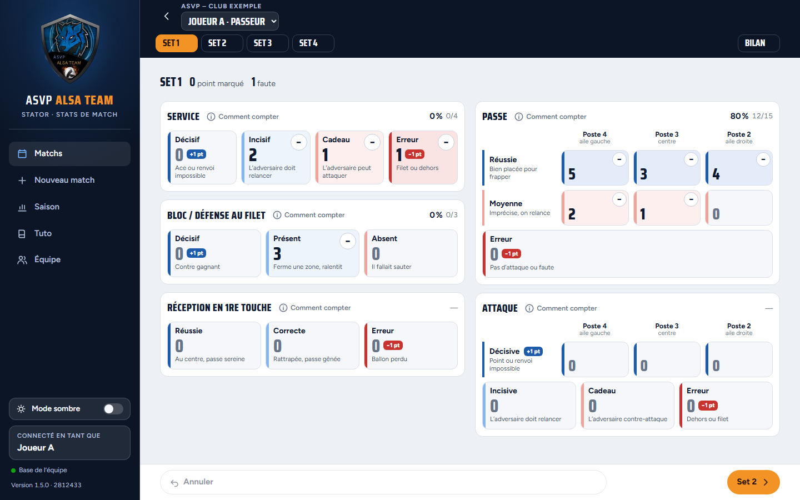
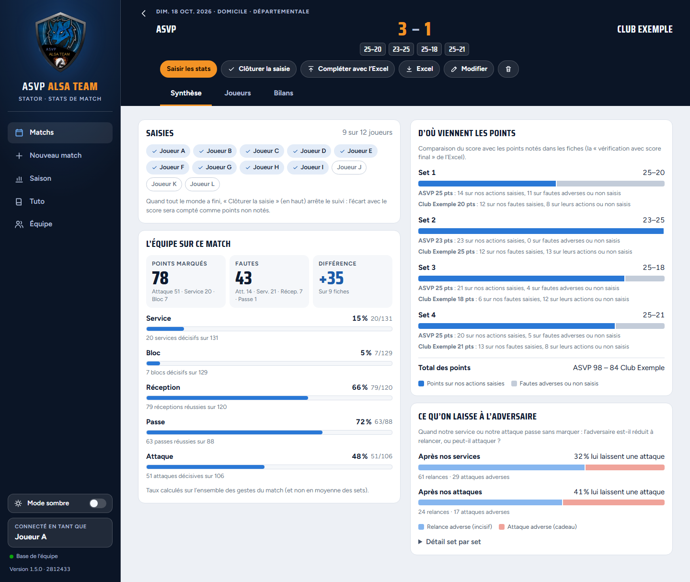
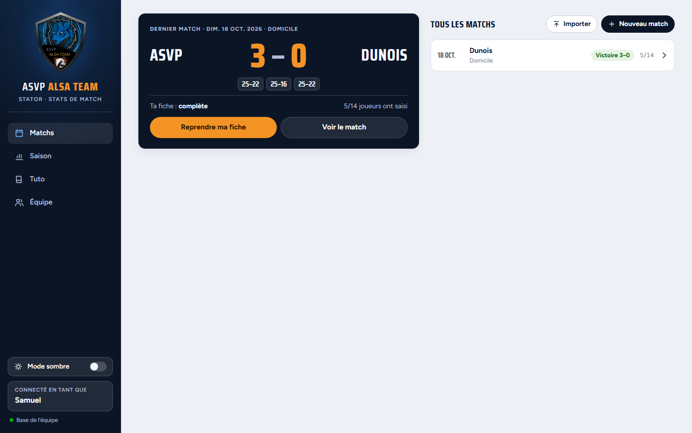
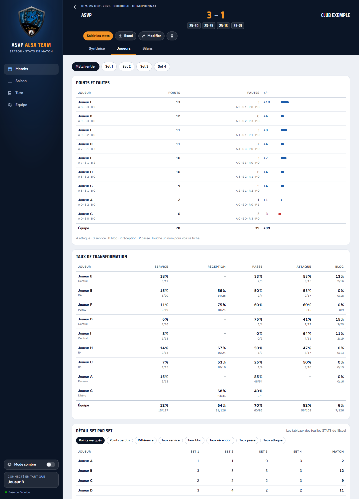
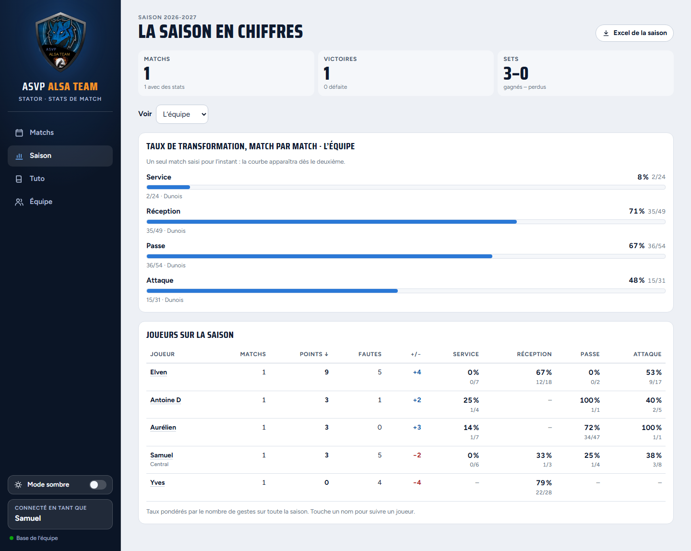
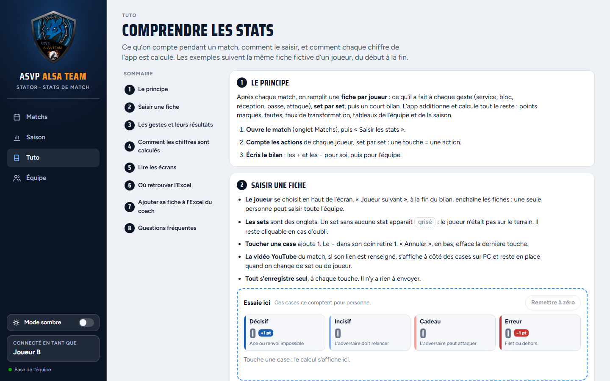
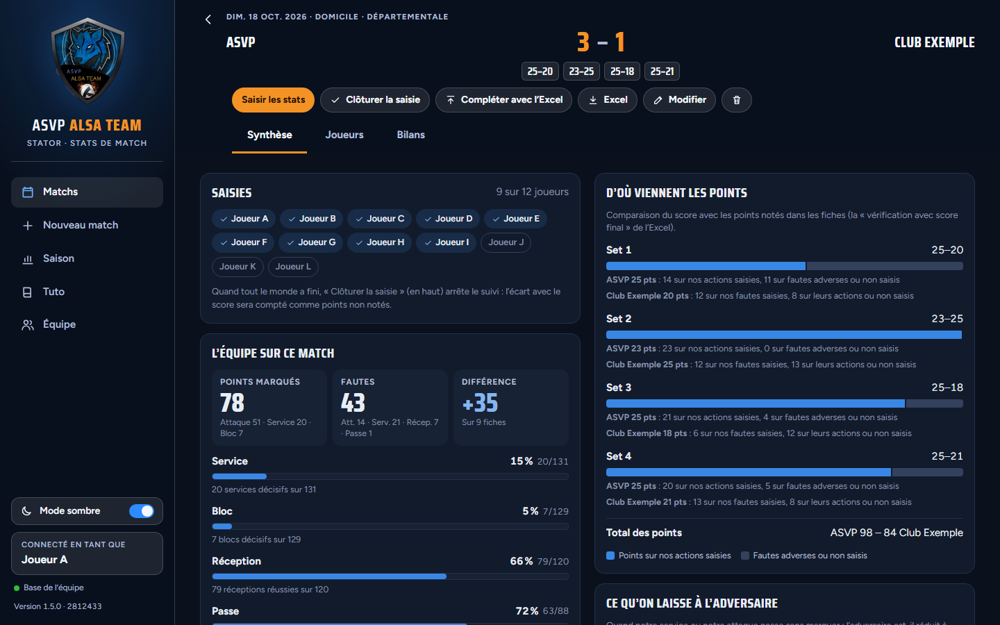
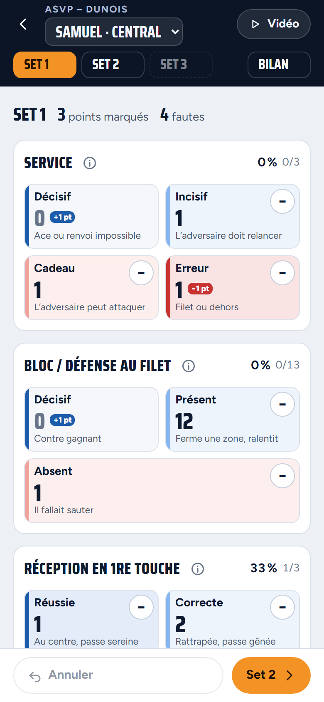
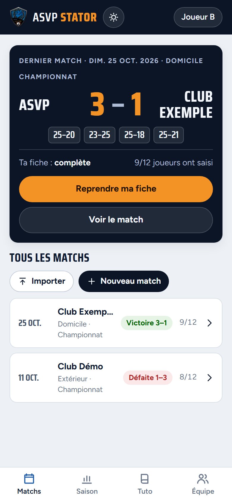

# ASVP Stator

Application de stats de match de l'ASVP Alsa Team (volley). Elle remplace le fichier Excel
« ASVP - <adversaire>.xlsx » rempli après chaque match : on compte les actions de chaque joueur
set par set (en revoyant la vidéo YouTube du match si besoin), chacun écrit son bilan, et
l'équipe retrouve les stats du match et de la saison. Le bouton « Excel » d'un match produit
toujours le fichier au format habituel, et chaque joueur peut télécharger sa fiche au format de
son onglet pour la coller dans l'Excel du coach (marche à suivre dans le Tuto de l'app).

## Aperçu

Captures réalisées avec des données fictives (joueurs, adversaires et stats inventés).

| Saisie d'une fiche | Synthèse d'un match |
|---|---|
|  |  |

| Accueil | Joueurs et détail set par set |
|---|---|
|  |  |

| Saison | Tuto | Mode sombre |
|---|---|---|
|  |  |  |

Sur téléphone :

<p>
  
  
</p>

## Lancer l'application sur son PC (pour tester)

Pour l'installer sur le serveur en ligne (PythonAnywhere), suivre plutôt [DEPLOIEMENT.md](DEPLOIEMENT.md) :
les commandes ci-dessous sont pour un ordinateur Windows.

Prérequis : Python 3.11 ou plus récent.

```bash
python -m venv .venv
.venv\Scripts\activate            # Windows  (macOS/Linux : source .venv/bin/activate)
pip install -r requirements.txt
flask --app stator run            # puis ouvrir http://127.0.0.1:5000
```

Les données sont enregistrées dans `instance/stator.db`, créé au premier lancement.
Tests : `pytest`.

## Organisation

```
stator/   serveur Flask : base de données (models.py) et API utilisée par la page (api.py, services.py)
web/      la page : index.html, scripts js/, logo img/, et referentiel.json (gestes, résultats, définitions)
tests/    tests automatiques
```

## Mise en ligne et mises à jour

Voir [DEPLOIEMENT.md](DEPLOIEMENT.md) : installation sur PythonAnywhere, mise à jour en une
commande (`bash deploy/mise-a-jour.sh`), vérification de la version en ligne, sauvegardes.

## Avant de mettre en ligne

L'application n'a pas encore de mot de passe : elle est faite pour être utilisée en local ou sur
un réseau de confiance. Avant de l'ouvrir sur Internet, il faut ajouter un mot de passe d'équipe
et la servir en HTTPS.

## Version de démonstration

Le dossier `web/` est aussi publié tel quel comme lien de démonstration (artefact Claude). Dans ce
cas les données sont stockées dans la base de l'artefact, séparée de celle du serveur Flask, et la
vidéo YouTube s'ouvre dans un nouvel onglet au lieu de s'afficher à côté des cases.
