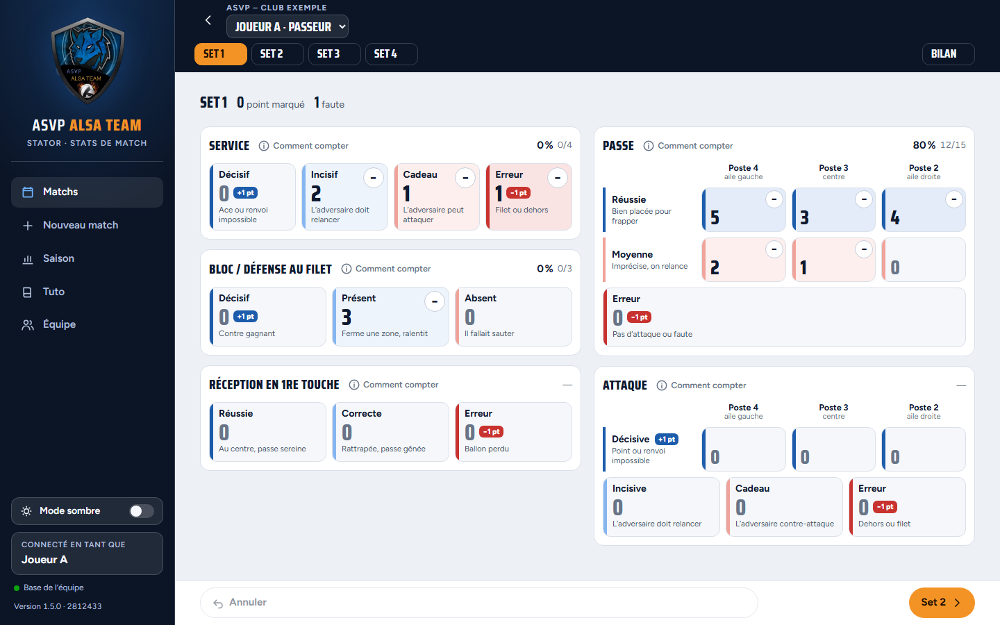
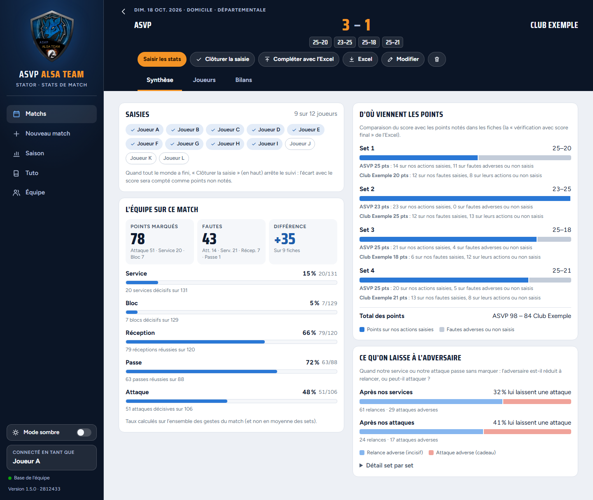
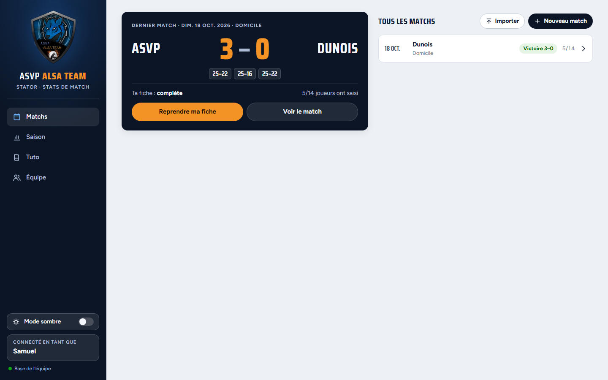
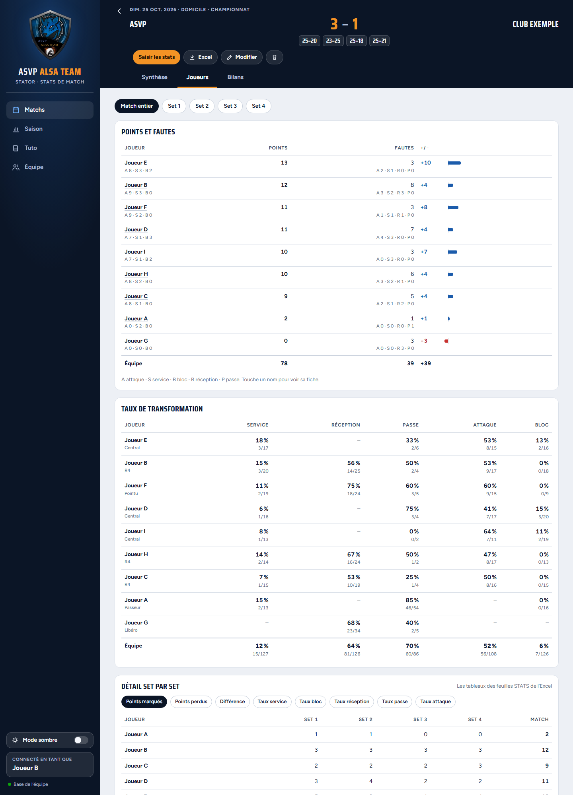
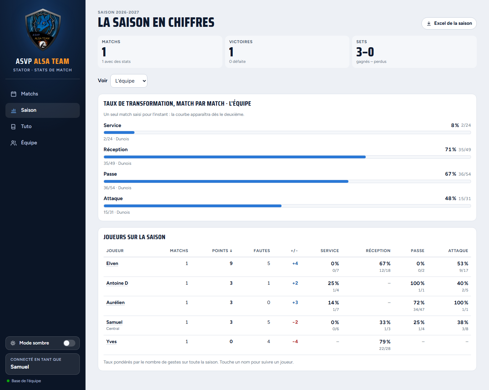
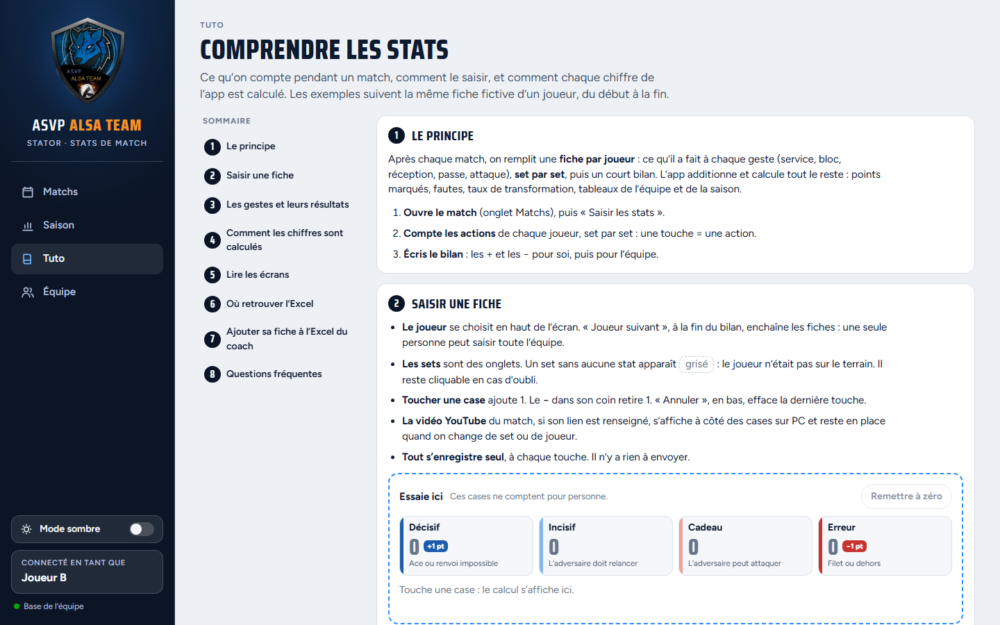
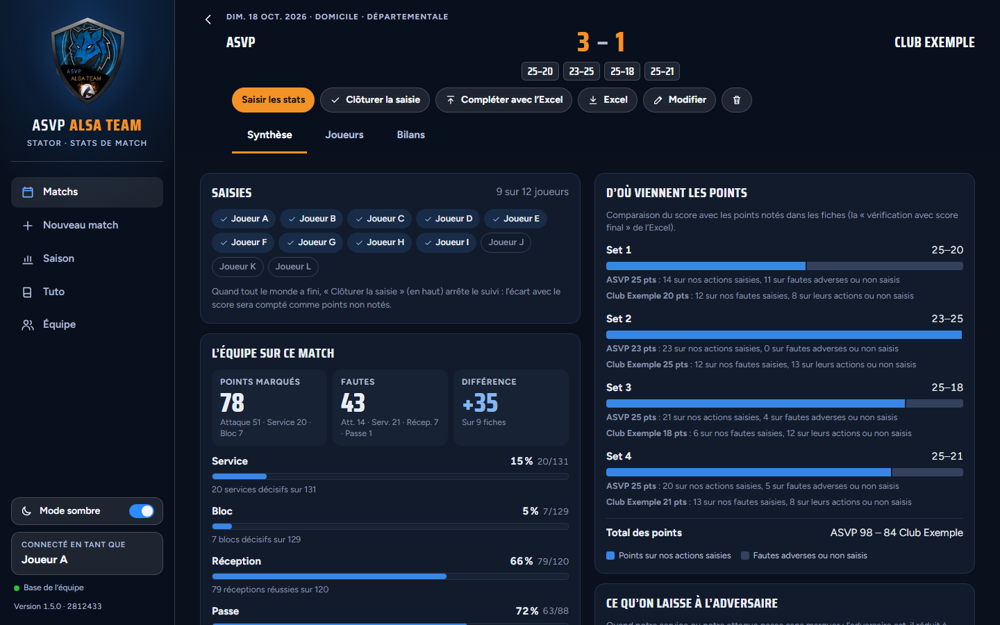
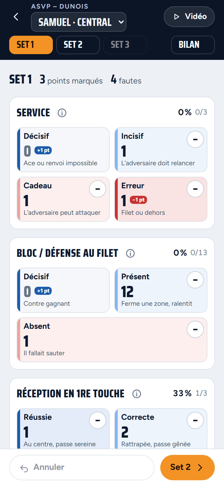
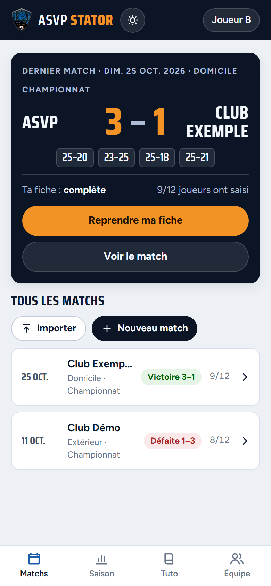

# ASVP Stator

Application de stats de match de l'ASVP Alsa Team (volley). Elle remplace le fichier Excel
« ASVP - <adversaire>.xlsx » rempli après chaque match : on compte les actions de chaque joueur
set par set (en revoyant la vidéo YouTube du match si besoin), chacun écrit son bilan, et
l'équipe retrouve les stats du match et de la saison. Le bouton « Excel » d'un match produit
toujours le fichier au format habituel, et chaque joueur peut télécharger sa fiche au format de
son onglet pour la coller dans l'Excel du coach (marche à suivre dans le Tuto de l'app).
L'accueil montre tous les matchs joués et le calendrier ; l'onglet Classement suit le championnat
FFVolley de l'équipe (classement, journées, fiche de chaque adversaire), actualisé chaque matin
depuis le site de la fédération (voir [DEPLOIEMENT.md](DEPLOIEMENT.md), partie 6).
Chaque match à venir a sa page : consignes du coach par priorité (rouge, orange, vert), compo sur le
terrain (une couleur par poste, libéro, binômes, remplaçants, compos types réutilisables), infos
pratiques (échauffement une heure avant, salle, itinéraire, maillots). Sur l'accueil, une barre suit les
fiches remplies ; un match complet s'affiche en vert.

## Deux équipes, un coach

La même app sert aussi l'équipe féminine 4x4 du coach, à l'adresse `/f4/` (en local :
http://127.0.0.1:5000/f4/). Chaque équipe a sa propre base (`instance/stator.db` pour l'ASVP,
`instance/stator-f4.db` pour le 4x4) : effectif, matchs et fiches ne se mélangent jamais.
Pour le 4x4 : compo à quatre en losange (pointe avant, deux ailes, pointe arrière, sans libéro), postes au féminin
(passeuse, attaquante, centrale, pointue), textes au féminin, et aucune donnée reprise d'Internet
(pas de classement FFVolley ni de logos adverses). Son thème, aux couleurs de l'équipe (#00aaff, #00f7ff,
#ffd447 : bandeaux bleus, boutons jaunes, en clair et en sombre), est dans `web/css/team-f4.css`. Nom et logo
sont provisoires : à changer dans [`stator/teams.py`](stator/teams.py) et `web/img/logo-f4.svg` quand le club
sera connu ; le nom court se règle aussi dans l'onglet Équipe.

Le **profil coach** est le seul à passer d'une équipe à l'autre : une fois connecté (« Espace coach »
en bas du menu, ou onglet Équipe), un sélecteur affiche ses deux équipes. Le profil se crée sur le
serveur avec `python -m stator.coach` (voir [DEPLOIEMENT.md](DEPLOIEMENT.md), partie 7).

## Aperçu

Captures réalisées avec des données fictives (joueurs, adversaires et stats inventés).

| Saisie d'une fiche | Synthèse d'un match |
|---|---|
|  |  |

| Accueil : matchs et calendrier | Joueurs et détail set par set |
|---|---|
|  |  |

| Saison | Tuto | Mode sombre |
|---|---|---|
|  |  |  |

Sur téléphone :

<p>
  
  
</p>

## Lancer l'application sur son PC (pour tester)

Pour l'installer sur le serveur en ligne (PythonAnywhere), suivre plutôt [DEPLOIEMENT.md](DEPLOIEMENT.md) :
les commandes ci-dessous sont pour un ordinateur Windows.

Prérequis : Python 3.11 ou plus récent.

```bash
python -m venv .venv
.venv\Scripts\activate            # Windows  (macOS/Linux : source .venv/bin/activate)
pip install -r requirements.txt
flask --app stator run            # puis ouvrir http://127.0.0.1:5000
```

Les données sont enregistrées dans `instance/stator.db`, créé au premier lancement.
Tests : `pytest`.

## Organisation

```
stator/   serveur Flask : base de données (models.py) et API utilisée par la page (api.py, services.py),
          équipes servies (teams.py), profil coach (coach.py)
web/      la page : index.html, scripts js/, logo img/, et referentiel.json (gestes, résultats, définitions)
tests/    tests automatiques
```

## Mise en ligne et mises à jour

Voir [DEPLOIEMENT.md](DEPLOIEMENT.md) : installation sur PythonAnywhere, mise à jour en une
commande (`bash deploy/mise-a-jour.sh`), vérification de la version en ligne, sauvegardes.

## Avant de mettre en ligne

Seul le coach a un mot de passe (pour le sélecteur d'équipe). Les joueurs et les joueuses n'en ont
pas : l'app est faite pour être utilisée en local ou sur un réseau de confiance. Avant de l'ouvrir sur Internet, il faut ajouter un mot de passe d'équipe
et la servir en HTTPS.

## Version de démonstration

Le dossier `web/` est aussi publié tel quel comme lien de démonstration (artefact Claude). Dans ce
cas les données sont stockées dans la base de l'artefact, séparée de celle du serveur Flask.
